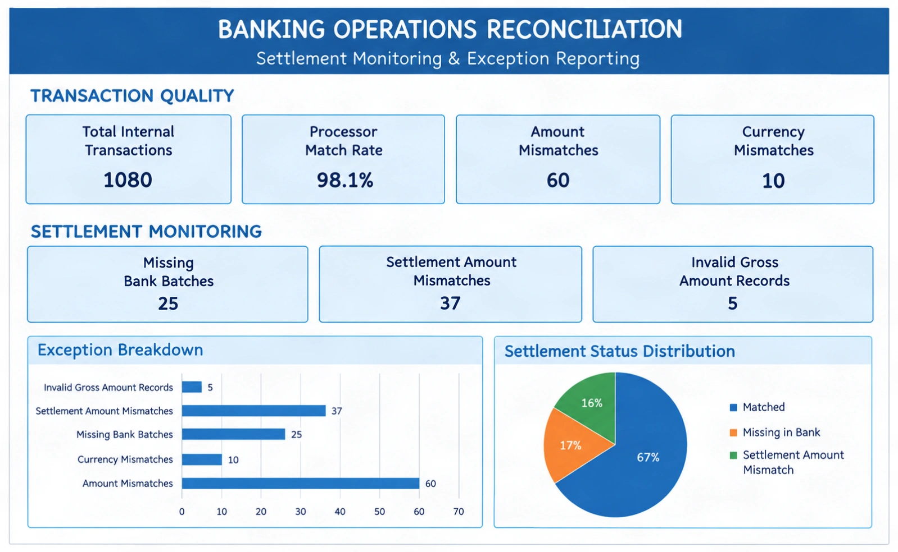

# Banking Operations Reconciliation & KPI Reporting

**Tools:** Microsoft Excel 365 · Power Query · Data Reconciliation · Data Quality Analysis · KPI Reporting

**Project Type:** Banking Operations & Data Analytics

**Status:** Completed — Excel analysis and dashboard

---

## Dashboard Preview

<!-- Save your final Excel dashboard screenshot as assets/reconciliation-dashboard.png -->
<!-- Create an "assets" folder in your repository and place the screenshot inside it. -->



*Figure 1. Excel dashboard summarizing transaction quality, settlement exceptions, and reconciliation status.*

---

## 1. Project Overview

This project demonstrates a banking operations reconciliation workflow using synthetic transaction data. The objective is to compare internal payment records with payment processor transactions and bank settlement records, identify discrepancies, assess data quality, and summarize operational exceptions through an Excel dashboard.

The workflow was developed using Microsoft Excel 365 and Power Query to import, transform, merge, group, and analyze transaction data.

The final workbook contains reconciliation queries, batch-level settlement comparisons, exception tables, KPI calculations, and a visual dashboard.

## 2. Business Problem

Payment operations teams need to verify that transactions recorded internally agree with processor records and that processor settlements are reflected in bank credits.

Differences between these records can indicate missing transactions, amount discrepancies, currency inconsistencies, settlement delays, or data quality problems.

Without a structured reconciliation process, these exceptions can be difficult to identify and investigate efficiently.

This project simulates that process using synthetic data and demonstrates how Excel and Power Query can support operational monitoring and exception reporting.

## 3. Project Objectives

- Compare internal payment records against processor transactions.
- Identify transactions missing from the processor dataset.
- Detect transaction amount and currency discrepancies.
- Aggregate processor transactions by settlement batch and currency.
- Compare processor net totals against bank credited totals.
- Identify missing bank settlement records and settlement amount mismatches.
- Isolate invalid gross-amount records.
- Summarize reconciliation results using KPI calculations and charts.
- Present the results in a consolidated Excel dashboard.

## 4. Dataset

**Source:** [ReconRiver Synthetic Reconciliation Dataset — Hugging Face](https://huggingface.co/datasets/heybadrinath/reconriver-synthetic-reconciliation)

The project uses synthetic banking and payment reconciliation data. It does not use real customer transactions or confidential banking records.

### Input files used

| File | Purpose |
|---|---|
| `internal_transactions.csv` | Internal payment records |
| `processor_transactions.csv` | Processor events, amounts, fees, and settlement batches |
| `bank_settlements.csv` | Bank settlement entries and credited amounts |

The dataset also contains other files, including expected reconciliation data and duplicate internal transaction data. The workflow documented here focuses on the three principal datasets imported into the reconciliation process.

### Key fields

**Internal transactions**
- `internal_payment_id`
- `merchant_order_id`
- `occurred_at`
- `gross_amount`
- `currency`
- `payment_status`
- `payment_method`
- `synthetic_customer_reference`

**Processor transactions**
- `processor_transaction_id`
- `merchant_order_id`
- `processor_event_type`
- `processor_event_time`
- `gross_amount`
- `fee_amount`
- `net_amount`
- `currency`
- `settlement_batch_id`
- `processor_status`

**Bank settlements**
- `bank_entry_id`
- `settlement_batch_id`
- `booked_at`
- `credited_amount`
- `currency`
- `bank_reference`
- `description`

## 5. Tools and Techniques

### Microsoft Excel 365
Used to organize the workbook, present KPI values, build charts, and create the final dashboard.

### Power Query
Used to import CSV files, merge datasets, create custom columns, group settlement data, filter exceptions, append queries, and prepare analysis tables.

### Reconciliation techniques
- Left Outer joins
- Transaction-level amount and currency comparisons
- Settlement batch aggregation
- Exception filtering
- Data quality checks
- KPI calculations and chart-based reporting

## 6. Methodology

### Step 1 — Import and prepare the data

Imported the internal transaction, processor transaction, and bank settlement CSV files into Excel through Power Query.

The source datasets were retained as separate queries so that they could be referenced by downstream reconciliation queries.

### Step 2 — Reconcile internal transactions with processor records

Created `Recon_Internal_Processor` by merging internal transactions with processor transactions using `merchant_order_id` and a Left Outer join.

Expanded the processor fields and created custom columns to classify processor matches, amount differences, and currency differences.

**Processor match logic:**

```powerquery
if [processor_transaction_id] = null
then "Missing in Processor"
else "Matched"
```

**Amount comparison logic:**

```powerquery
if [processor_transaction_id] = null then "Missing in Processor"
else if [gross_amount] = [#"gross_amount.1"] then "Match"
else "Amount Mismatch"
```

**Currency comparison logic:**

```powerquery
if [processor_transaction_id] = null then "Missing in Processor"
else if [currency] = [#"currency.1"] then "Match"
else "Currency Mismatch"
```

These columns provide a structured way to classify differences between the internal and processor records.

### Step 3 — Summarize processor settlement batches

Created `Processor_Batch_Summary` by grouping processor records by `settlement_batch_id` and `currency`.

The summary includes:
- `Processor_Event_Count`
- `Processor_Gross_Total`
- `Processor_Fee_Total`
- `Processor_Net_Total`

A custom column named `Gross_Amount_Clean` was created to convert valid gross amounts to numbers while safely handling invalid values.

```powerquery
try Number.From([gross_amount]) otherwise null
```

This allows valid records to remain usable in the summary while invalid gross amounts can be investigated separately.

### Step 4 — Summarize bank settlements

Created `Bank_Batch_Summary` by grouping bank settlement records by `settlement_batch_id` and `currency`.

The summary includes:
- `Bank_Entry_Count`
- `Bank_Credited_Total`

This provides the bank-side settlement totals needed for batch-level comparisons.

### Step 5 — Reconcile processor batches with bank settlements

Merged `Processor_Batch_Summary` with `Bank_Batch_Summary` using `settlement_batch_id` and `currency`, with a Left Outer join.

Expanded the bank summary fields and created a `Settlement_Status` column.

**Settlement status logic:**

```powerquery
if [Bank_Credited_Total] = null then "Missing in Bank"
else if Number.Abs([Processor_Net_Total] - [Bank_Credited_Total]) < 0.01
then "Matched"
else "Settlement Amount Mismatch"
```

This classifies processor-side batches as matched, missing in bank, or having a settlement amount mismatch.

### Step 6 — Create exception reports

Created separate exception queries to support investigation and reporting:

| Query | Purpose |
|---|---|
| `Amount_Exceptions` | Records classified as amount mismatches |
| `Currency_Exceptions` | Records classified as currency mismatches |
| `Transaction_Exceptions` | Appended amount and currency exception results |
| `Settlement_Exceptions` | Batch-level settlement exceptions |
| `Data_Quality_Exceptions` | Invalid gross-amount records |

The `Invalid_Gross_Amount` flag identifies rows where `Gross_Amount_Clean` is null.

The exception tables make it easier to review issues without manually inspecting every source record.

### Step 7 — Build KPI reporting

Created a `KPI_Dashboard` worksheet with KPI cards, a horizontal bar chart, and a settlement status pie chart.

The dashboard summarizes transaction quality, settlement exceptions, and reconciliation status.

Supporting tables hold the calculated values used to build the charts.

## 7. KPI Dashboard and Results

The workbook's current supporting calculations report the following results:

| KPI | Reported result |
|---|---:|
| Total internal transactions | 1,080 |
| Processor match rate | 98.1% |
| Amount mismatches | 60 |
| Currency mismatches | 10 |
| Missing bank batches | 25 |
| Settlement amount mismatches | 37 |
| Invalid gross-amount records | 5 |
| Matched settlement batches | 157 |

*These are the reported workbook results. The figures should be interpreted within the scope of the implemented joins, grouping rules, and status logic.*

## 8. Business Findings

### 8.1 Transaction matching

The reported processor match rate is 98.1%, indicating that most internal transaction records were classified as matched by the implemented matching logic.

The remaining unmatched or discrepant records require investigation to establish the underlying operational cause.

### 8.2 Amount discrepancies

The exception report contains 60 records classified as amount mismatches.

Potential investigation areas include differences in transaction amounts, event handling, or the relationship between internal and processor records. The mismatch count alone does not establish the cause of each discrepancy.

### 8.3 Currency discrepancies

The workbook identifies 10 records classified as currency mismatches.

Currency inconsistencies should be reviewed before transactions are considered successfully reconciled. The affected records should be checked against their source values and applicable transaction details.

### 8.4 Missing bank settlement records

The batch-level comparison identifies 25 processor-side settlement batches without a matching bank summary entry under the implemented join keys.

These batches should be reviewed to determine whether the cause is a missing bank record, a settlement timing difference, or an identifier or currency mismatch.

### 8.5 Settlement amount mismatches

The workbook classifies 37 processor-side settlement batches as having settlement amount mismatches.

These exceptions require comparison of the processor net total and bank credited total, along with checks of fees, refunds, event signs, settlement timing, and batch composition.

### 8.6 Data quality

Five processor records contain invalid gross-amount values that could not be converted into numbers.

The `Gross_Amount_Clean` transformation prevents these values from causing numeric conversion errors in the gross-total aggregation and makes them available for separate investigation.

Invalid values should be corrected at the source or reviewed before being used in financial calculations.

### 8.7 Matched settlement batches

The workbook reports 157 settlement batches as matched under the implemented settlement status rule.

A matched classification means that the compared processor net total and bank credited total satisfy the current tolerance rule. It does not, by itself, prove that every individual transaction or event in the batch is correct.

## 9. Operational Recommendations

Based on the exception categories produced by this workflow, the following follow-up actions are appropriate:

1. Investigate amount mismatches by comparing the original internal and processor values.
2. Review currency discrepancies against the source transaction records.
3. Check missing bank batches against bank statements and settlement timing.
4. Investigate settlement amount mismatches using processor net amounts, fees, refunds, and bank credits.
5. Correct invalid gross-amount values in the source system where appropriate.
6. Maintain an exception log with an assigned owner, investigation status, resolution notes, and closure date.
7. Refresh the reconciliation after updated source data becomes available.

These are recommended investigation steps, not claims that the underlying causes have already been established.

## 10. Limitations and Assumptions

- The analysis uses synthetic data and is intended for learning and portfolio demonstration.
- The internal-to-processor merge uses `merchant_order_id`. If multiple processor events exist for one order, the join can create multiple rows and affect counts or match rates.
- Processor records include capture and refund event types. Refund treatment and event signs must be considered when interpreting gross and net settlement totals.
- The processor-to-bank reconciliation uses a Left Outer join from processor batches to bank batches. This identifies processor-side batches without matching bank entries but does not independently identify bank-only batches.
- Settlement status is determined using the implemented comparison rule and a tolerance of less than 0.01.
- Amount and currency exception reports may contain the same transaction if it has both types of discrepancy.
- The current dashboard's KPI cards are text boxes. Unless linked to worksheet cells, their displayed values must be updated manually when the underlying results change.

These limitations define the scope of the current implementation and identify possible improvements for a future version.

## 11. Project Deliverables

The project workbook contains:
- Imported source datasets
- Internal-to-processor reconciliation query
- Processor batch summary
- Bank batch summary
- Processor-to-bank reconciliation
- Transaction, settlement, and data quality exception queries
- KPI dashboard
- Supporting KPI and chart tables

## 12. Skills Demonstrated

- Excel 365 data analysis
- Power Query data transformation
- Data merging and aggregation
- Transaction reconciliation
- Settlement batch comparison
- Exception reporting
- Data quality checks
- KPI calculation and dashboard design
- Operational findings and recommendations
- Business-oriented documentation

## 13. Repository Structure

Suggested GitHub repository layout:

```text
banking-operations-reconciliation/
│
├── README.md
├── Banking_Operations_Reconciliation.xlsx
│
└── assets/
    └── reconciliation-dashboard.png
```

The `assets/reconciliation-dashboard.png` file should contain the final dashboard screenshot.

## 14. Conclusion

This project demonstrates an Excel-based approach to banking operations reconciliation, settlement monitoring, and data quality reporting.

Power Query was used to combine internal payment records, processor transactions, and bank settlement data; classify exceptions; aggregate settlement batches; and prepare reporting tables. Excel was then used to present key reconciliation indicators and exception categories through a dashboard.

The project provides a foundation for further improvements, including automated refresh workflows, more comprehensive duplicate and refund handling, and two-way settlement reconciliation.

---

**Disclaimer:** This is an educational portfolio project using synthetic data. It is not a production banking reconciliation system and does not represent the processes or systems of any specific bank.
